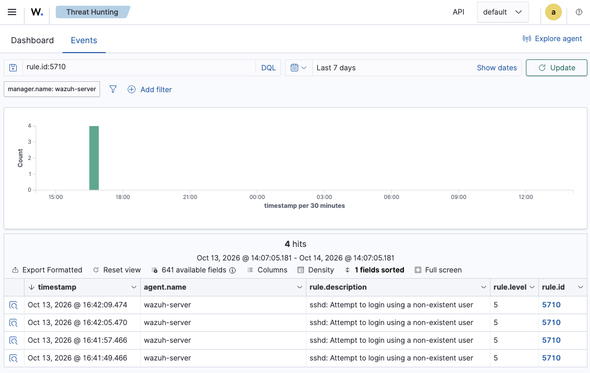
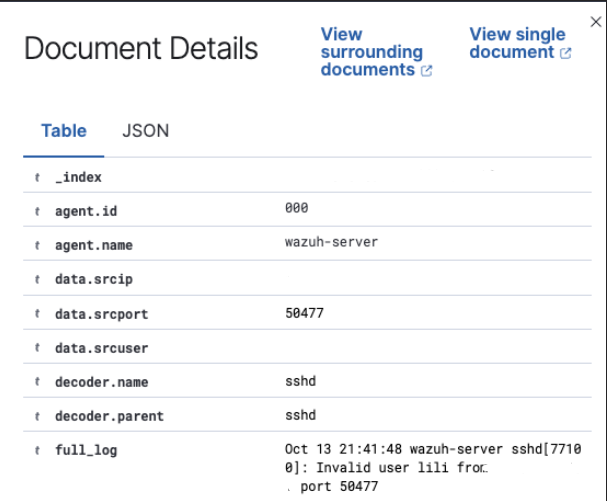
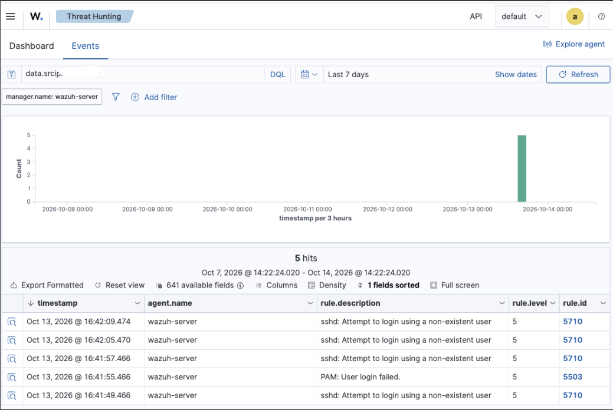

**Date:** 2026-10-13 
**Analyst:** Lilia 
**Status:** Closed

## Summary
On 2026-10-13, Wazuh detected 4 failed SSH login attempts against wazuh-server from internal IP [REDACTED-INTERNAL-IP], targeting the non-existent user `lili`. No successful login followed. The activity was an authorized test performed by the analyst from the lab host machine. Verdict: benign true positive.

## Alert Details
| Field | Value |
|---|---|
| Rule ID | 5710 |
| Rule level | 5 (Low) |
| Description | sshd: Attempt to login using a non-existent user |
| Timestamp | 2026-10-13 16:41:49 → 16:42:09 CDT (4 events) |
| Agent | wazuh-server (ID 000, Wazuh manager) |
| Source IP | [REDACTED-INTERNAL-IP] |
| Target user | lili (does not exist on host) |


## MITRE ATT&CK
- **Tactic:** Credential Access
- **Technique:** T1110.001 – Brute Force: Password Guessing

## Raw Log
```
Oct 13 21:41:48 wazuh-server sshd[77100]: Invalid user lili from [REDACTED-INTERNAL-IP] port 50477
```



## Investigation
- 4 failed SSH login attempts in 20 seconds from [REDACTED-INTERNAL-IP], all targeting the non-existent user `lili`.
- Interval between attempts (4–8 s) suggests manual attempts rather than an automated tool, which would typically generate many attempts per second.
- Source IP is internal to the lab network (host machine), not an external address.
- Raw log timestamp is in UTC (21:41); the dashboard shows local time (CDT, UTC-5). Timestamps normalized to CDT in this report.
- [x] Checked all events from [REDACTED-INTERNAL-IP] in the last 7 days: 5 events, all failures (4× rule 5710, 1× rule 5503 PAM login failed). No successful authentication (rule 5715) from this source. The attack was unsuccessful.




## Verdict
**Benign true positive.** The detection worked correctly: real failed logins occurred and were alerted on. The activity was authorized testing, not malicious.

## Response & Recommendations
- No containment needed (authorized test, no successful access).
- Recommend disabling SSH password authentication and requiring key-based login.
- Recommend fail2ban or Wazuh active response to block source IPs after repeated failures.
- Recommend rotating the Wazuh admin password, since it was displayed during installation.