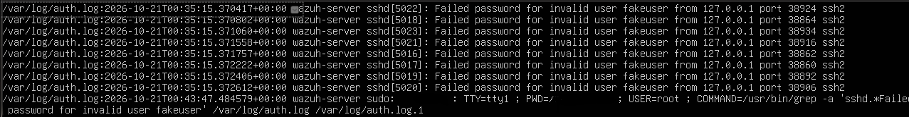

**Date:** 2026-10-20 - 2026-10-21 
**Analyst:** Lilia 
**Status:** Completed

---

## Objective

Reproduce the TR-001 failed-login scenario in **Splunk** instead of Wazuh, using **SPL (Search Processing Language)**, so the two SIEMs (Security Information and Event Management) can be compared under the same situation. This report documents the investigation that led to the Splunk detection, including the failed attempts. 

---

## Background: checking what was already in the logs

Before generating any new activity, I checked whether the host already held failed-login evidence from TR-001:

### Step 1 — Initial count

```
sudo grep -a "Failed password" /var/log/auth.log* | wc -l
```

Result: **10 matches.** `-a` forces grep to read the file as text. The log contained some non-text bytes and grep refuses to search it otherwise.

### Step 2 — False positive #1

Reading the actual lines showed the matches were **my own `sudo grep` commands**, logged by the system's auth/audit logging because they contained the text "Failed password." The search was matching itself.

> **Lesson:** a keyword match is not an event. `sudo` activity is recorded in the auth.log, so searching for a string that appears in your own command produces false hits.

### Step 3 — Filter to the SSH service

```
sudo grep -a "sshd.*Failed password" /var/log/auth.log* | wc -l
```

Restricting to lines from the `sshd` process (the SSH server) dropped the count to **7**, then review showed **6 genuine SSH failures** plus more of my own command lines (**false positive #2**).

### Step 4 — Investigate the real events

The 6 genuine failures:

```
Failed password for invalid user [REDACTED] from [REDACTED-INTERNAL-IP] port ***** ssh2
```

- **Invalid user** = the account does not exist on the host (a login typo).
- **Source:** [REDACTED-INTERNAL-IP] — the lab host machine (internal, mine).
- **Timing:** spread over minutes, in two small clusters — consistent with manual typing, not automation.

**Verdict on existing data:** benign, manual user error. Matches TR-001's conclusion.

---

## Decision point

Six manual failures from a single internal IP are too few to show what a brute-force attack really looks like in a SIEM. SPL excels at spotting a fast cluster of failures from one IP. My manual attempts were too slow to form one, so I needed an automated attack to show it.

>[!info] **Decision:** 
>Escalate from manual attempts to a **controlled, automated brute-force using Hydra**, run from the lab host against the lab VM.

## Attack simulation — Hydra

**Tool:** Hydra v9.5 (installed on the lab VM via `apt`) 
**Type:** Authorized brute-force simulation against my own lab VM 
**Command:**

```bash
hydra -l fakeuser -P passwords.txt ssh://127.0.0.1
```

- `-l fakeuser` — single, non-existent username (every attempt fails → clean pattern).
- `-P passwords.txt` — list of 8 fake/weak passwords (no real credentials).
- `ssh://127.0.0.1` — SSH service on localhost; the VM attacks itself.

**Hydra result:** `8 login tries (l:1/p:8)` → `0 valid password found`. Start 00:35:15 → finish 00:35:15 UTC = **8 attempts within the same second (00:35:15).**

>[!note] All the timestamps share **00:35:15**

### Events generated

Filtering to the SSH service and the attack username:

```bash
sudo grep -a "Failed password for invalid user fakeuser" /var/log/auth.log*
```

**8 genuine failed logins**, all timestamped `2026-10-21 00:35:15 UTC`, all from `127.0.0.1`, each on a different source port (38924, 38864, 38934, …).

### Count discrepancy — investigated, not assumed

|Count seen|Explanation|
|---|---|
|`17 − 7 = 10` new matches on `sshd.*Failed password`|8 attack events + 2 false positives|
|`9` matches on `invalid user fakeuser`|8 attack events + 1 false positive|
|**8** actual `sshd` attack events|the true count|

**False positives:** the extra matches were my own `sudo grep` commands, logged to the auth log because the command text contained the search phrase ("Failed password … invalid user fakeuser"). Confirmed by reading the lines: they are `sudo … COMMAND=grep …`, not `sshd` events.

>[!warning] **Lesson:** 
>A raw keyword count is unreliable: the search command is itself logged, so it can match its own entries. Filter on the `sshd` process and verify timestamps before trusting a number.



### Automation signature

All 8 failures landed in the **same one-second window** from a single source. Contrast with TR-001, where manual attempts were spaced 4–8 seconds apart. Speed and clustering are the fingerprint that separates an automated brute-force from manual login errors.

**Confirmed attack events:** 8 failed SSH logins from 127.0.0.1 against `fakeuser`.

## Splunk setup

### Environment & data

- Platform: Splunk Cloud trial. 
	- Sourcetype `linux_secure` 
	- Index `lab_linux`
	- Host `wazuh-server`
- Evidence: `TR-002_auth.log` (working copy), ingested via Add Data at Splunk Cloud Interface.

### Methodology (the pipeline)

**Step 1 - Scope the search to the index.**
`index=lab_linux`
*Why*: It tells Splunk where to look. Returned 100 events - the full log, mostly noise.

**Step 1.1 - Break down by process**  
`index=lab_linux | stats count by process`  
_Why:_ shows the 100 events span 7 processes (sshd, cron, sudo…). Only sshd holds the attack.

**Step 2 - Filter to SSH failures.**
`index=lab_linux process=sshd "Failed password"`
*Why*: It narrows the search to sshd failures and just the "Failed password" event.

**Step 3 - Extract the source IP and count.**
`index=lab_linux process=sshd "Failed password" | rex "from (?<src_ip>\d+\.\d+\.\d+\.\d+)" | stats count by src_ip`
*Why*: `linux_secure` didn't extract the IP, so `rex` creates the `src_ip` field, then `stats` counts attempts per attacker. 

**Step 4 - Rank and threshold.**
`index=lab_linux process=sshd "Failed password" | rex "from (?<src_ip>\d+\.\d+\.\d+\.\d+)" | stats count by src_ip | sort -count | where count > 5`
*Why*: `sort-count` puts the worst offender first; `where count > 5` keeps only IPs above an attempt threshold. 

### Findings

- 100 events.
- 8 failed SSH logins, `invalid user fakeuser`, from `127.0.0.1`, clustered in 1 second.
- Verdict: **true positive**, brute-force attempt.

### Analyst notes / limitations

- The attack came from 127.0.0.1 (my own machine). A real attack would come from one or more outside IP addresses.
- Only 8 attempts - a small, controlled test, not a big real attack. The same commands would work with more data.
- Splunk did not pull out the IP automatically with `linux_secure`, so I used `rex` to extract it. In a real setup, this would be configured once so it's automatic.
- One machine, one log file. Real investigations usually look across several machines and log types.

## MITRE ATT&CK

- **Tactic:** Credential Access - attacker tried to obtain valid credentials by guessing.
- **Technique:** T1110.001 — Brute Force: Password Guessing. Trying many passwords against an account. 
- **Why it maps:** Hydra tried 8 passwords against one SSH account in under a second — password guessing against a single user, which is exactly T1110.001.

## Wazuh vs Splunk comparison
The next table describes the process of each aspect in both tools:

| Aspect           | Wazuh (TR-001)                          | Splunk (TR-002)            |
| ---------------- | --------------------------------------- | -------------------------- |
| Detection method | Built-in rule (5710) auto classified it | Manual SPL query           |
| Source IP        | Extracted automatically as a field      | Required `rex` extraction  |
| Severity         | Auto-assigned (level 5)                 | Analyst judges it manually |
| Strength         | Fast, pre-built detection               | Flexible -  query anything |
| Weakness         | Limited to existing rules               | More manual effort         |


Wazuh classified the event, extracted the source IP, and assigned a severity automatically, the software did the analysis for me. Splunk presented raw events and left the analysis to me: I wrote the SPL and extracted the source IP myself with `rex`. Wazuh is faster out of the box but Splunk is more flexible.

## Verdict & recommendations

**Verdict:** True positive — a brute-force attempt against SSH (T1110.001). 
8 failed logins against a non-existent user from one source in under a second, 
confirmed by timing and clustering.

**Recommendations (to research further):**
- Limit repeated failed logins from the same source (look into rate-limiting / fail2ban).
- Consider SSH key authentication instead of passwords.
- Turn the detection query from this lab into an automated alert that fires when failed logins from one IP cross a threshold. (My `where count > 5` query is the logic; configuring it as a scheduled alert is a next step I'd need to learn.)