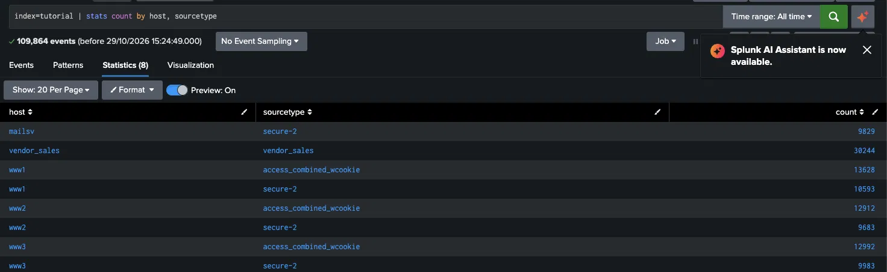
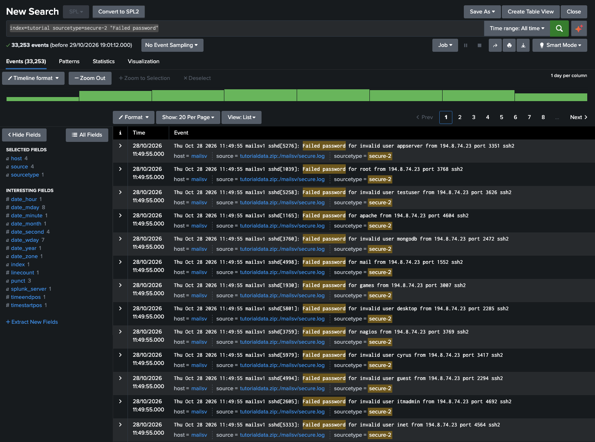
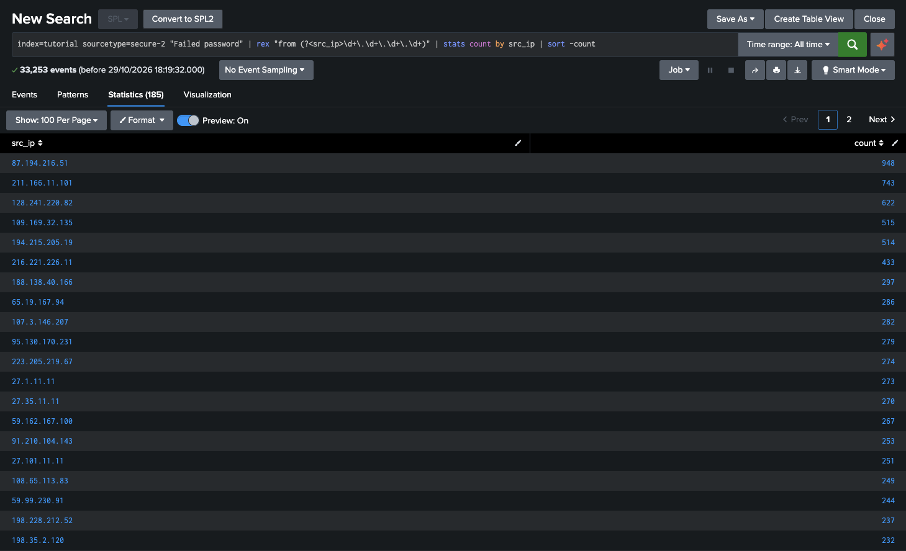
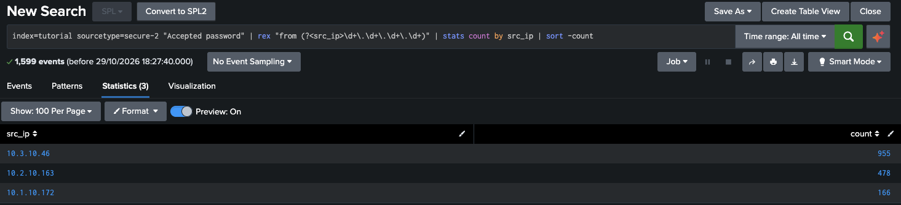
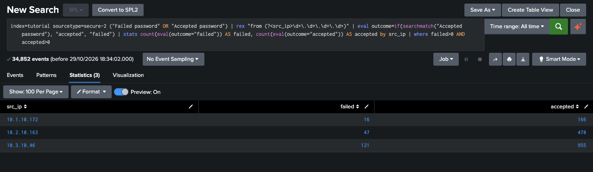
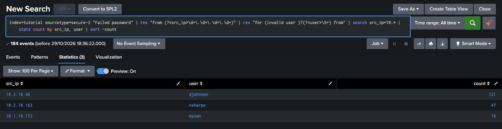

**Date:** 2026-10-29 
**Analyst:** Lili 
**Status:** Completed

---

## Objective

Investigate failed SSH logins in the tutorial dataset and determine whether any attacker gained access.

---

## Environment & data

| Item       | Details                             |
| ---------- | ----------------------------------- |
| SIEM       | Splunk Enterprise running on Docker |
| Index      | tutorial                            |
| Sourcetype | secure-2                            |
| Hosts      | www1, www2, www3, mailsv            |
| Time range | All time                            |

 We have 109,864 events across 5 hosts: mailsv, vendor_sales, www1, www2, www3.
 
```
index=tutorial | stats count by host, sourcetype
```
 


---

## Methodology
### Step 1 - Reviewing the raw failed-login events

```
index=tutorial sourcetype=secure-2 "Failed password"
```

The query searches for “Failed password” only in the secure-2 sourcetype, where SSH login events are stored



### Step 2 — Pulling out the IP of the dataset

```
index=tutorial sourcetype=secure-2 "Failed password" | rex "from (?<src_ip>\d+\.\d+\.\d+\.\d+)" | stats count by src_ip | sort -count
```

The query pulls out the IP field. `rex` finds the IP after the word "from" and saves it as a new field called `src_ip`; `stats count by src_ip` counts failures for each IP; `sort -count` puts the biggest attacker at the top.

The result was 185 IP addresses for "Failed password". 



### Step 3 — Finding the successful logins

```
index=tutorial sourcetype=secure-2 "Accepted password" | rex "from (?<src_ip>\d+\.\d+\.\d+\.\d+)" | stats count by src_ip | sort -count
```
The query look for "Accepted password". And the results are 3 local IPs. 



### Step 4 - Investigating IPs that succeeded after several failed attempts

```
index=tutorial sourcetype=secure-2 ("Failed password" OR "Accepted password") | rex "from (?<src_ip>\d+\.\d+\.\d+\.\d+)" | eval outcome=if(searchmatch("Accepted password"), "accepted", "failed") | stats count(eval(outcome="failed")) AS failed, count(eval(outcome="accepted")) AS accepted by src_ip | where failed>0 AND accepted>0
```
The query look for both failed and succeeded IPs. The results are 3 local IPs:



### Step 5 - Investigating which accounts failed from the internal IP's we discovered in Step 4

```
index=tutorial sourcetype=secure-2 "Failed password" | rex "from (?<src_ip>\d+\.\d+\.\d+\.\d+)" | rex "for (invalid user )?(?<user>\S+) from" | search src_ip=10.* | stats count by src_ip, user | sort -count
```
As it seems, the failed attempts were to valid accounts. 




---

## Findings

- The tutorial dataset contains 109,864 events across 5 hosts; 4 hosts (www1, www2, www3, mailsv) have SSH authentication logs (sourcetype secure-2). 
- 33,253 failed SSH logins ("Failed password") were recorded. - The failures came from 185 distinct source IPs: 182 external (public) and 3 internal (10.x.x.x). 
- Top 3 sources of failures: 87.194.216.51 (948), 211.166.11.101 (743), 128.241.220.82 (622). 
- External sources tried many different usernames within the same second (e.g. 194.8.74.23: appserver, root, testuser, apache, mongodb, mail). Some targeted accounts exist on the server (root, apache, mail, nagios); others do not ("invalid user"). 
- 1,599 successful logins ("Accepted password") were recorded, all from 3 internal IPs: 10.3.10.46 (955), 10.2.10.163 (478), 10.1.10.172 (166). 
- None of the 182 external IPs had a successful login. 
- The 3 internal IPs also had failed logins: 10.3.10.46 (121), 10.2.10.163 (47), 10.1.10.172 (16), roughly 9–11% of their login attempts. 
- Each internal IP failed on one account only: djohnson (10.3.10.46), nsharpe (10.2.10.163), myuan (10.1.10.172).

---

## Verdict

**Verdict:** True positive, no compromise. 182 external IPs ran automated brute-force attacks against SSH, but none succeeded. The 3 internal IPs with failed logins are benign: each failed only on its own account, at a rate consistent with typing errors.

---

## MITRE ATT&CK

- **Tactic:** Credential Access
- **Technique:** T1110 — Brute Force (sub-technique not confirmed: consistent with T1110.003 Password Spraying or T1110.004 Credential Stuffing)
- **Why it maps:** Several External IPs attempted SSH logins against many different accounts within seconds, including default service accounts like root, apache and mail. 

---

## Analyst notes / limitations

- The dataset has been generated and downloaded from Splunk, so it's not possible to knowing which IPs are normal or expected for the organization. 
- The internal failed logins are assumed to come from the account owners. A follow-up investigation should confirm whether each user really mistyped, or whether their computer has remote access that could let an attacker act from that internal IP.
- The queries matched exact phrases (“Failed password”, “Accepted password”), so log lines written in a different format, or other types of access, were not included.
- This investigation covered failed and successful login attempts only, not the commands or actions performed after a successful login.

---

## Recommendations
- Investigate the activity of djohnson's account (10.3.10.46) after its successful logins, since it had the most failed attempts (121). 
- Limit repeated failed logins from the same source (rate-limiting/fail2ban). It automatically blocks an IP for a period of time after a set number of failed attempts.  
- Change settings in the SSH configuration file:

	- PermitRootLogin no. Nobody can log in as root over SSH.
	- PasswordAuthentication no. SSH stops accepting passwords and only accepts SSH keys.

- **Save the query that looks for several failed attempts and succeeded after that. Set an alert with the query with a trigger condition and an action to be notified.**

---

## Lessons learned

- At first glance, one IP had many failed attempts within a one-second window, but it was not even in the top 20 IPs by failed attempts once the data was counted and sorted. **The first thing you see is not necessarily the biggest problem.**
- After running the “Accepted password” query, I concluded too fast that an external IP had gained access. That was wrong: all the results were internal IPs. **Verify before concluding.**
- Always back up findings with supporting evidence, and write “consistent with” when something is inferred rather than proven.
- A new mental model: treat the data as a system. Where does an entry come from, what does it do inside the system (the logs), and how does it look once it becomes an output (filtered data after SPL queries)?
