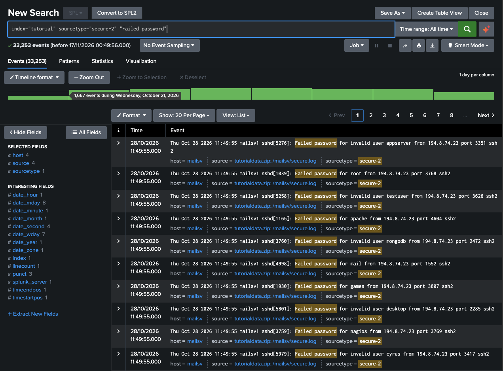

**Date:** 2026-11-16 (ISO 8601) 
**Analyst:** Lilia 
**Status:** Completed

## Objective

A Sigma rule will be created to detect logs containing "Failed password", in the secure-2 sourcetype, where SSH login events are stored. The result will be compared against TR-003 SPL query I wrote manually. 

## Detection summary

| Item         | Details                                             |
| ------------ | --------------------------------------------------- |
| Rule file    | rules/ssh_failed_password.yml                       |
| Rule ID      | 13fe01a3-c5ce-4955-a005-8f6a8161aa70                |
| Level        | low                                                 |
| MITRE ATT&CK | Credential Access, T1110 Brute Force                |
| Log source   | Linux, auth (SSH authentication logs)               |
| Target SIEM  | Splunk Enterprise in Docker                         |
| Validation   | Passed: 33,253 events, matching the TR-003 baseline |

## Environment

| Tool      | Version                      |
| --------- | ---------------------------- |
| sigma-cli | 4.0.1                        |
| pySigma   | 2.1.0                        |
| Backend   | pySigma-backend-splunk 3.0.1 |
| Python    | Python 3.13.2                |

The tools run in a project-local Python virtual environment (.venv) excluded from Git. All package versions are pinned in requirements.txt, so the environment can be rebuilt with pip install -r requirements.txt.

## Rule logic

```yaml
title: SSH Failed Password Attempt
id: 13fe01a3-c5ce-4955-a005-8f6a8161aa70
status: experimental
description: Detects failed SSH password authentication attempts in Linux authentication logs.
author: Lilia Elba Martinez Rosas
date: 2026-11-16
tags:
  - attack.credential-access
  - attack.t1110

logsource:
  product: linux
  service: auth
detection:
  keywords:
    - "Failed password"
  condition: keywords
falsepositives:
  - Legitimate users mistyping their password
level: low

```

- logsource: tells the rule which logs to read: Linux authentication logs (linux/auth), where SSH records every login attempt.
- detection: the search itself. The keywords block matches the phrase "Failed password" anywhere in the event.
- condition: tells Sigma how to combine the detection blocks. This rule has only one, keywords.
- level: the severity. It's low because a single failed password is common. 

## Field mapping (pipeline)

Sigma uses generic log source names (`linux` / `auth`), while Splunk uses its own index and sourcetype names. The pipeline translates one into the other, so the converted query searches only the right data.

```yaml
name: Lab Splunk mapping
priority: 100
transformations:
  - id: linux_auth_to_tutorial
    type: add_condition
    conditions:
      index: tutorial
      sourcetype: secure-2
    rule_conditions:
      - type: logsource
        product: linux
        service: auth

```

| Conversion       | Output                                                   |
| ---------------- | -------------------------------------------------------- |
| Without pipeline | "Failed password"                                        |
| With pipeline    | index="tutorial" sourcetype="secure-2" "Failed password" |

## Validation

The resulting query was tested in Splunk Enterprise on the same data used in TR-003. The results were the same as the ones from the SPL query I typed manually.



**Result:** Passed. 33,253 results with the manual SPL query vs 33,253 with the Sigma rule.

## Reproduce

```
cd "0.6 Detection Engineering"
python3 -m venv .venv
source .venv/bin/activate
pip install -r requirements.txt
sigma check rules/ssh_failed_password.yml
sigma convert -t splunk -p pipelines/lab_splunk.yml rules/ssh_failed_password.yml
```

On macOS with Python from python.org, run Install Certificates.command once first.
## Troubleshooting log

| Problem                                         | Cause                                                      | Fix                                             |
| ----------------------------------------------- | ---------------------------------------------------------- | ----------------------------------------------- |
| brew install pipx hung with no output           | Unresolved: brew itself responded and the network was fine | Used Python's built-in venv instead             |
| sigma crashed after installing the kusto plugin | Plugin incompatible with pySigma 2.1.0                     | Uninstalled it with pip; KQL conversion pending |
| venv broke after renaming the folder            | A venv stores its absolute path                            | Recreated it from requirements.txt              |
| Splunk returned 0 events                        | Time range set to "All time (real-time)"                   | Switched to "All time"                          |

## Next steps
- Rule 2: brute-force correlation rule (many failures from one IP within a time window).
- Find a KQL backend compatible with pySigma 2 and convert the rules for Microsoft Sentinel. 
- Run sigma check automatically on every push with GitHub Actions.

## Lessons learned
- At this stage, a rule needs to be checked against the manual query.
- Pinned versions let me rebuild the environment in seconds after breaking it.